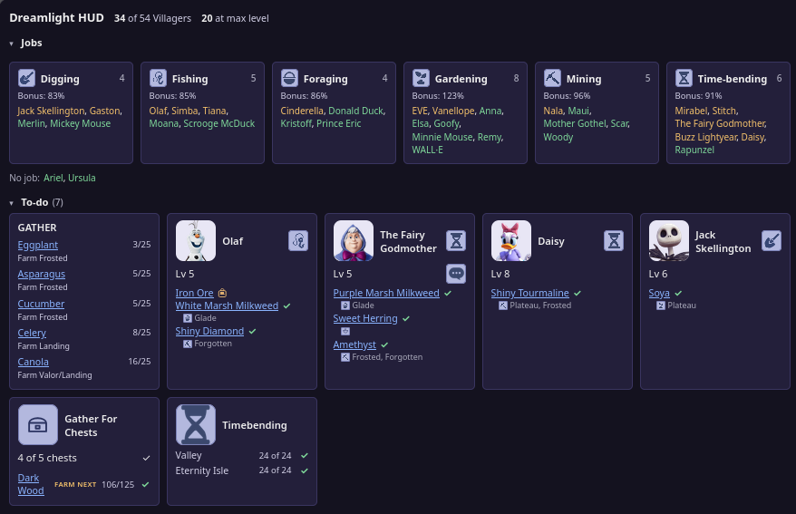
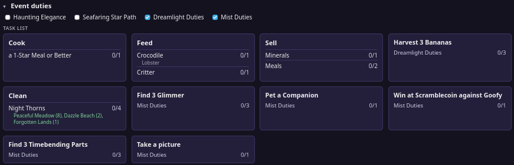
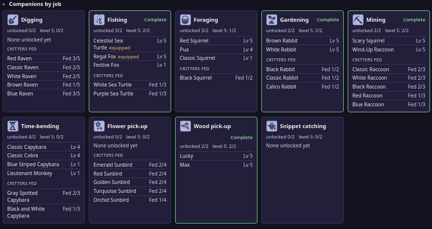

# Dreamlight HUD

A read-only companion for Disney Dreamlight Valley. It reads your own save file and shows
Villager jobs, Companion jobs, daily to-dos, event duties and more in a clean page or its own
window. It never writes to your game folder and sends nothing anywhere.

## What it shows

**Jobs and To-do.** Every Villager grouped by Profession, with the Profession's bonus chance. Below it,
the To-do list shows only the Villagers who still need attention (below max level with Daily talk or a
Favorite gift outstanding). Each card lists the gifts, with a check once you hold the item and where it
spawns. "Gather For Chests" counts raw materials toward 5 Large Chests, and Time-bending shows which
areas still have nodes.

**Event duties.** Star Path and Dreamlight/Mist duties in one task list. Duties that one action can
advance together are grouped into a single card, and the list is ordered so you can work top to bottom.
Use the checkboxes to hide a Star Path you are not playing.

**Companions by job.** Which Companions you have unlocked for each Job, which are equipped, and how far
each Critter has been fed. A green outline means you have enough level 5 Companions for this Job
to equip two of them.

The HUD shows what is in your save file, not live game state. The page re-reads the save every few
seconds, but the numbers only change after the game writes a new save. The footer shows when the save
was last written, so you can tell how fresh the data is.

## Safe to use

This is not a mod, a cheat or a trainer. It never touches the game: it does not run inside it, read its
memory, change its files or talk to its servers. All it does is open your save file the way any other
program opens a file, and show you what is in it. It asks for no login or password, makes no network
requests of its own (the page is served only to your own computer, on `127.0.0.1`), and sends nothing
anywhere. The code is all here to read. This is an unofficial fan tool, so Disney and Gameloft have not
approved it and I cannot speak for their rules.

## Your save is never modified

The save is only ever read. Nothing is written to your save or game folder, and the code is covered by a
test that fails if it tries. The one file the app writes is its own settings (the save folder you chose),
under `%APPDATA%\DreamlightHUD` on Windows or `~/.config/ddvhud` on Linux.

## Windows

Download `DreamlightHUD.exe` from the [latest release](../../releases/latest) and run it.
Windows SmartScreen may warn about an unsigned app: click **More info**, then **Run anyway**.
If your save is not found, use **Choose save folder…** and pick the folder that contains
`steam_*`. The default is `%USERPROFILE%\AppData\LocalLow\Gameloft\Disney Dreamlight Valley`.

## From source

    pip install cryptography            # needed to decrypt the save file (plus pywebview for window mode)
    python3 -m ddvhud --window          # own window
    python3 -m ddvhud --duty            # narrow window straight into Duty mode (also at /duty)
    python3 -m ddvhud --port 8765       # browser at http://127.0.0.1:8765/
    python3 -m ddvhud --save PATH       # save folder or profile.json

Tests: `python3 -m unittest discover -s tests`

## Legal

Unofficial, fan-made, and not affiliated with Disney or Gameloft. Code is MIT licensed
(see `LICENSE`). Character portraits and icons under `ddvhud/static/` are Disney/Gameloft
artwork, are not covered by that license, and are included only to identify game content.
Disney Dreamlight Valley and its characters are trademarks and copyrights of Disney and
Gameloft. Recipe and item data comes from the community
[Dreamlight Valley Wiki](https://dreamlightvalleywiki.com/).
